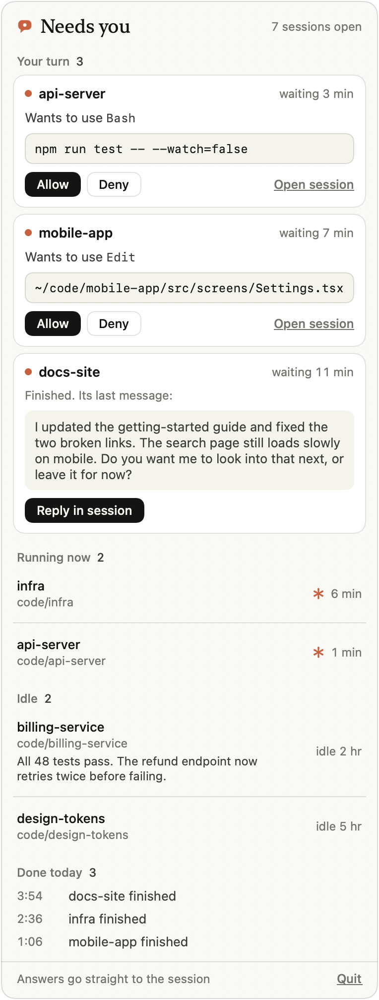
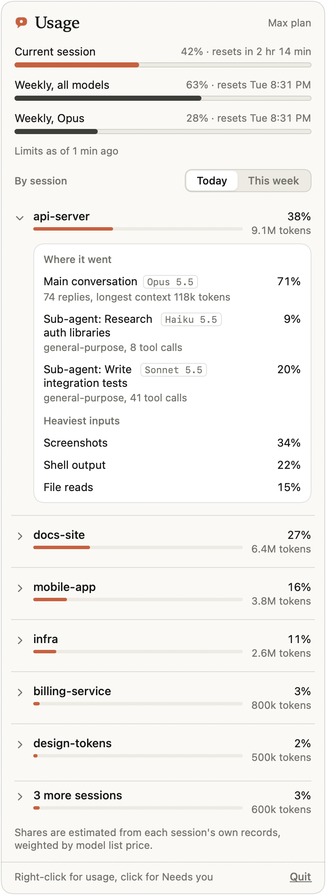
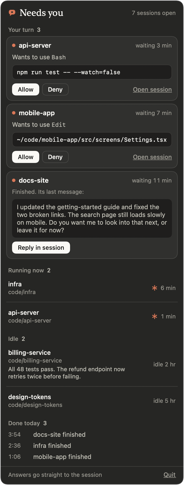
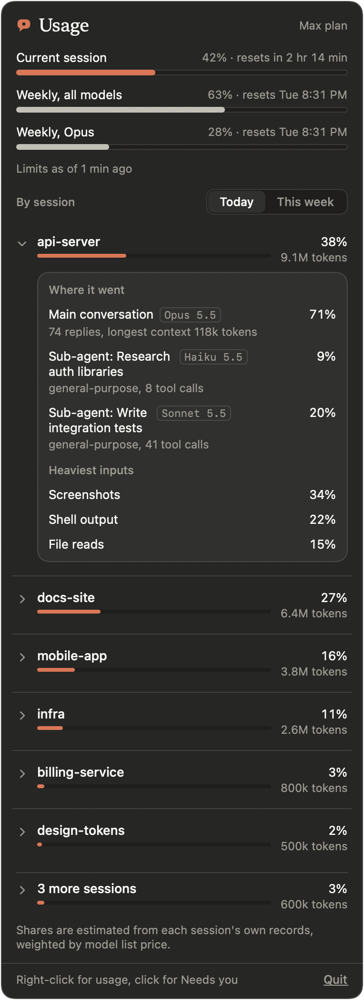

# Needs You

A macOS menu bar app for people who run several Claude Code sessions at once. It shows what is
waiting on you across every session, lets you answer permission prompts from the menu bar,
and shows where your usage is going, session by session.

- **Click** the icon: **Needs you**. Permission prompts from any session, with the exact
  command and Allow / Deny buttons. Sessions that finished, with their last message so you can
  see what they're asking. What is running now, which sessions are idle, and what finished
  today. Click any session to jump straight to it in the Claude desktop app.
- **A coloured dot on the icon** tells you at a glance: red, a permission prompt is waiting;
  yellow, a session finished and is waiting for your reply; blue, sessions are working; green,
  nothing needs you.
- **Right-click** the icon: **Usage**. Your plan limits (current session and weekly), then
  usage by session for today or this week. Expand a session to see its main conversation
  against each sub-agent, the models they used, and which inputs (screenshots, shell output,
  file reads) cost the most.

| Needs you | Usage |
|---|---|
|  |  |
|  |  |

*Screenshots use demo data.*

Works with sessions in the terminal and in the Claude desktop app. Everything stays on your
Mac: no server, no network calls, no account.

## How it works

```
Claude Code session ── PermissionRequest hook ──▶ ~/.claude/needs-you/pending/<id>.json
        ▲                  (waits for an answer)                  │
        └──── allow / deny ◀── answers/<id>.json ◀──── menu bar app
```

- A [Claude Code hook](https://code.claude.com/docs/en/hooks) writes each permission prompt to
  a folder and waits. When you click Allow or Deny, the app writes the answer back and the hook
  hands it to Claude Code.
- **If the app isn't running, nothing changes.** The hook sees that and exits at once, and you
  get the normal prompt. If you don't answer within 5 minutes, it steps aside the same way.
- Allow from the menu is the same as Allow in the session. Your deny and ask rules still
  apply, and there is no "allow everything" button.
- Session status comes from Claude Code's own session files. Usage comes from the session
  transcripts already on your disk, weighted by each model's list price so that cheap cache
  reads don't dominate. Plan limits come from a small status line script that saves the numbers
  Claude Code already passes to the status line.

The file format is in [docs/PROTOCOL.md](docs/PROTOCOL.md).

## Install

Requires macOS 14 or later, Xcode command line tools (Swift 6) and Python 3.

```bash
git clone https://github.com/auto-mo/needs-you.git && cd needs-you
```

```bash
./app/build.sh && cp -R "app/build/Needs You.app" ~/Applications/
```

```bash
python3 scripts/install.py
```

```bash
open ~/Applications/"Needs You.app"
```

The installer:
- backs up `~/.claude/settings.json`;
- adds the hooks next to any you already have;
- wraps your existing status line, if you have one, so it still prints what it printed before.

Run it with `--dry-run` first to see the exact changes. Hooks take effect in sessions you start
after installing.

Options:
- `--no-statusline` skips the status line script. You get no plan-limit bars, and everything
  else works.
- `--use-claude-icon` uses the menu bar icon from your own Claude desktop app instead of the
  default mark. The icon is copied on your machine only; it is not part of this repo.

### Uninstall

```bash
python3 scripts/install.py --uninstall
```

This removes only what the installer added and restores your previous status line. Then quit
the app and delete it.

## Notes and limits

- Opening a session uses the Claude desktop app's own `claude://code/continue` link, so it works
  for desktop sessions. Terminal sessions are listed but can't be opened from the menu.
- Usage shares are estimates from local transcripts. Your actual plan usage is the limits bar
  at the top of the Usage panel.
- Claude Code's session files are an internal format. If a Claude Code update changes them,
  "Running now" may go empty until this app is updated; Allow and Deny don't depend on them.

## Not affiliated with Anthropic

This is an independent project. Claude and Claude Code are trademarks of Anthropic. This repo
does not include Anthropic's logos. The default icon is an original mark.

## License

MIT
